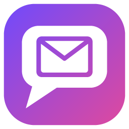
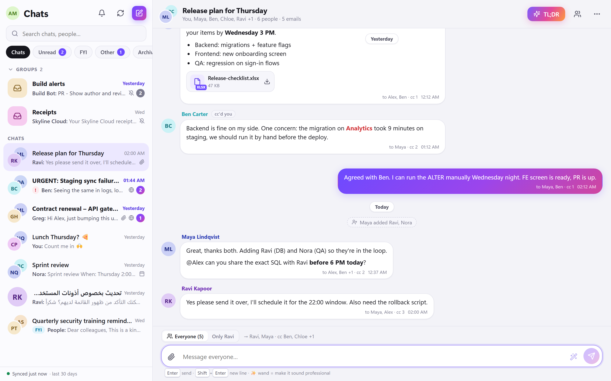
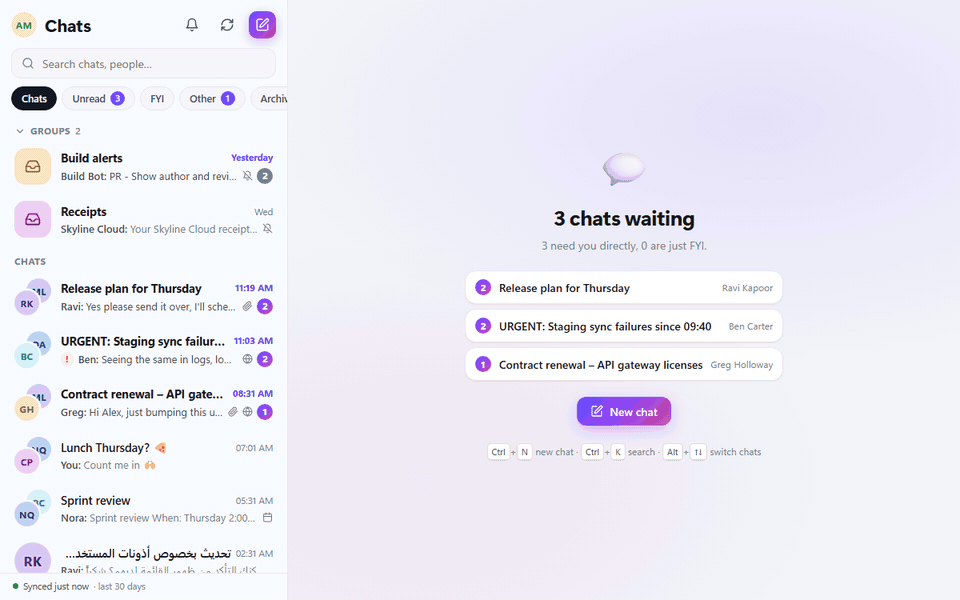
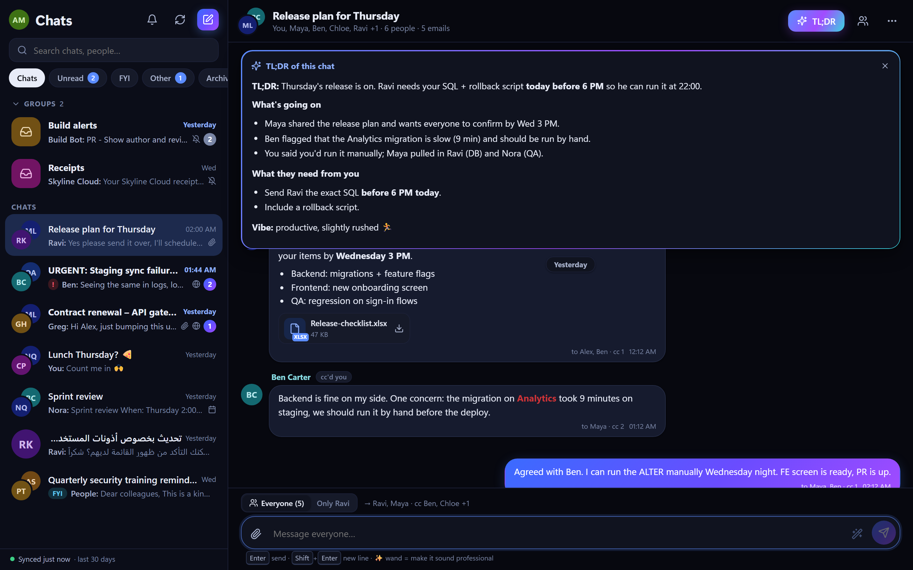
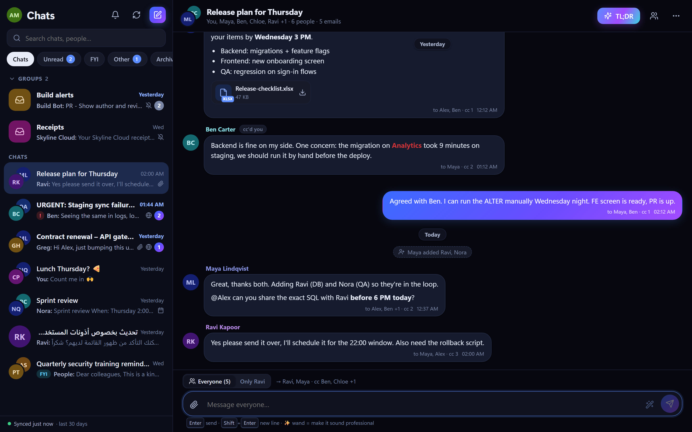
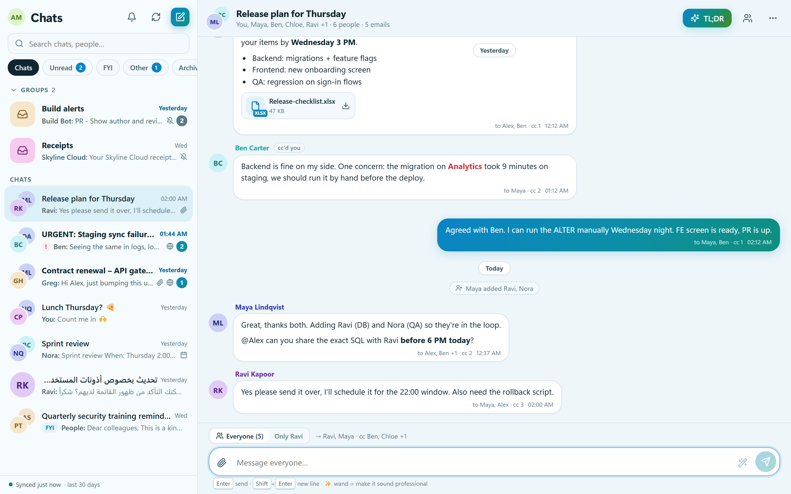
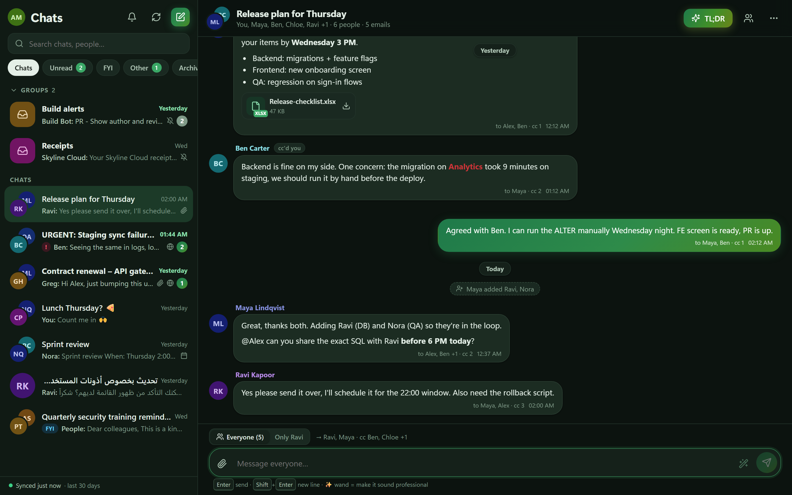
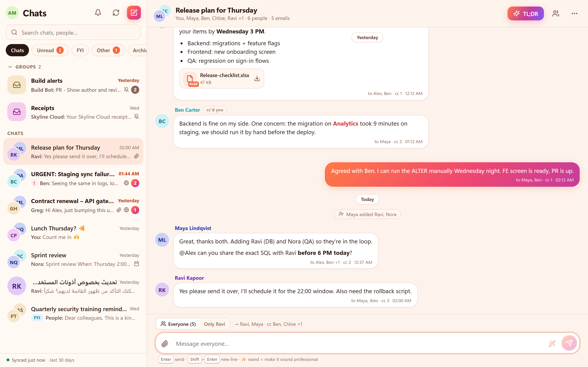
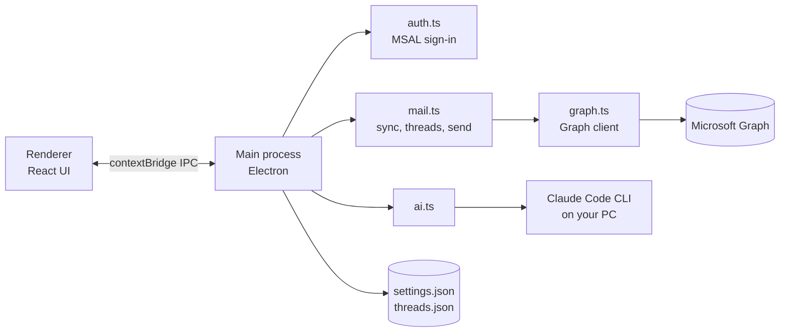

<div align="center">



# Mail Chat

Your Outlook inbox, but it's a group chat.

[](LICENSE)
[](#getting-started)
[](https://www.electronjs.org/)
[](https://www.typescriptlang.org/)

<picture>
  <source media="(prefers-color-scheme: dark)" srcset="docs/screenshots/chat-midnight.png">
  
</picture>

</div>

Mail Chat is a Windows desktop app that reads your Microsoft 365 mailbox and shows every email thread as a group chat. Each thread becomes a group named after its subject, each email becomes a chat bubble, and typing in the box sends a real, threaded Reply All.

<div align="center">



</div>

## Download

Get the latest version from the [Releases page](https://github.com/Omar2-8/mail-chat/releases/latest).

1. Download `Mail.Chat.Setup.1.0.0.exe` for the installer, or `Mail.Chat.1.0.0.exe` for the portable version that runs without installing. GitHub shows dots where the files have spaces.
2. Open the file. Windows may show "Windows protected your PC" because the app is not code signed yet. Select More info, then Run anyway.
3. Choose the sign-in button that matches your account: work or school for Microsoft 365, personal for Outlook.com, Hotmail or Live.
4. The installed version updates itself: it checks for new releases at launch and offers a restart when one is ready. The portable version does not update itself.
5. If your organization blocks the app, Mail Chat explains why and gives you a button that copies the details for your IT team. See [If sign-in fails](#if-sign-in-fails).

## The problem

An email thread is a conversation, but an inbox shows it as a stack of documents.

A single reply can arrive wrapped in an external-sender warning, a greeting, a sign-off, a signature, a legal footer and the entire quoted history underneath. To find what someone said, you scroll past most of the message. To answer, you pick between Reply and Reply All and type above a wall of quoted text.

Joining a thread late is worse. The messages from before you were added exist only as quoted text inside later emails, so the context is there but hard to see. And if you sort mail into Outlook folders to keep them quiet, most other clients make those folders noisy again.

## How it got to the solution

Each step in the app answers one of those frustrations.

1. **Group by conversation.** The app uses the Microsoft Graph `conversationId` to turn each thread into one chat, so a ten-message thread is one row in the sidebar.
2. **Show only what was written.** Each message uses the unique part of the body, and a trimming pass removes banners, greetings, sign-offs, signatures, "Sent from..." lines and disclaimers. A toggle in Settings shows the original email on any bubble.
3. **Rebuild the missing history.** When you were added late, the app parses the quoted older emails inside later messages and turns them into "earlier history" bubbles, in order.
4. **Reply inside the thread.** The composer creates a Graph reply-all draft, writes your text above the quoted history and sends it, so the reply stays in the same conversation in Outlook. It never uses `sendMail`, which would start a new thread.
5. **Respect your folders.** Outlook folders become groups, and they start silent, the same way Outlook treats them.
6. **Add help where it saves time.** TL;DR and Explain summarize a thread, and Polish turns a quick draft into a professional reply. They run through the Claude Code CLI on your machine, so no API key is involved.

## Features

- Every email thread appears as a chat, with day separators, a note when people are added to the thread, and "cc'd you" or "via list" labels.
- Outlook folders appear as groups that you can open, silence or unsilence.
- Search covers subjects, previews, senders and participants across all threads.
- Filters for Chats, Unread, FYI, Other and Archived. Pin, mute, archive or move a chat to a group from the right-click menu.
- Notification rules: pause for an hour, until tomorrow or until you resume, set quiet hours and quiet days, silence newsletters, automated senders, FYI mail, external senders or meeting invites, mute people or keywords, and mark VIPs that always get through.
- Plain-text or HTML signatures, with a logo, or imported from Outlook. Logos go out as inline images so they show up in Outlook, Gmail and on phones.
- Attachments open, save and drag in. Large files upload in chunks.
- Seven themes, a tray icon, an unread badge on the taskbar, and Windows toast notifications.

<div align="center">



<sub>TL;DR summarizes a thread and lists what is being asked of you.</sub>

</div>

## Themes

Pick a theme in Settings, General. Match Windows, Light and Dark come with it, along with four named themes.

<table>
  <tr>
    <td align="center"><br><sub>Midnight</sub></td>
    <td align="center"><br><sub>Ocean</sub></td>
  </tr>
  <tr>
    <td align="center"><br><sub>Forest</sub></td>
    <td align="center"><br><sub>Sunset</sub></td>
  </tr>
</table>

## Getting started

You need Windows, Node.js 22.12 or newer and npm. The project is developed and tested on Windows 11 with Node.js 26.

### Try the interface without an account

The UI runs in a normal browser against built-in sample mail, so you can look around without signing in to anything.

```powershell
git clone https://github.com/Omar2-8/mail-chat.git
cd mail-chat
npm install
npm run ui
```

Open http://localhost:5181. Add `?signin` to the address to see the signed-out screen. In this mode, sent replies and AI results are simulated.

### Run the desktop app

```powershell
npm install
npm run dev
```

The first window shows the sign-in screen. Choose Sign in with a work or school account or Sign in with a personal account and finish in your browser. If the browser flow does not work, choose "Use a code instead" and enter the device code at the link shown.

### Build an installer

```powershell
npm run dist:dir
```

This writes an unpacked app to `dist\win-unpacked`. Use `npm run dist` to produce the installer and the portable build.

## Signing in

The sign-in screen has two buttons. Sign in with a work or school account (Microsoft 365, Office 365) uses the `organizations` authority. It asks for these delegated permissions: `User.Read`, `User.ReadBasic.All`, `People.Read`, `Mail.ReadWrite` and `Mail.Send`.

Sign in with a personal account (Outlook.com, Hotmail, Live) uses the `consumers` authority and asks only for `User.Read`, `Mail.ReadWrite` and `Mail.Send`. Directory and people search is thinner for personal accounts: the recipient picker only suggests people from your recent threads.

Both buttons use the Mail Chat app registration built into the app, which accepts work, school and personal Microsoft accounts. Some organizations still block new apps or require an admin to approve the mail permissions. If sign-in fails with a consent or blocked-app message, ask your admin to approve Mail Chat, or register your own app:

1. In the Microsoft Entra admin center, go to App registrations and choose New registration.
2. Name it, pick the account types you need, and add a Public client/native redirect URI of `http://localhost`.
3. Under Authentication, turn on Allow public client flows. The device-code fallback needs this.
4. Under API permissions, add the five delegated Microsoft Graph permissions above and ask an admin to grant consent if your organization requires it.
5. Copy the Application (client) ID and start the app with it:

```powershell
$env:MAIL_CHAT_CLIENT_ID = "your-client-id"
$env:MAIL_CHAT_TENANT_ID = "your-tenant-id"
npm run dev
```

`MAIL_CHAT_TENANT_ID` is optional and defaults to `organizations`. It applies to work and school sign-in only. `MAIL_CHAT_PERSONAL_CLIENT_ID` sets a separate client ID for personal sign-in and falls back to `MAIL_CHAT_CLIENT_ID`.

### If sign-in fails

Instead of a raw error, the sign-in screen shows a short explanation and what to do next. The common messages:

- Your organization needs to approve Mail Chat: an admin has to approve the app first. It is not a problem with your password. Send your IT admin the details.
- Your organization does not allow Mail Chat on this device or network: a security rule such as Conditional Access blocked the sign-in. Try your usual work device or network, or ask IT.
- Mail Chat is not available for your organization yet: the app is not allowed or not registered in your organization. IT can add it.
- This account does not match the button you used: try the other button, work or school versus personal.
- Mail Chat is not set up correctly: the app registration or redirect settings are wrong. Contact the developer.
- Sign-in was cancelled: nothing is wrong. Press the button to try again.
- Could not reach Microsoft: check your internet connection, VPN or proxy.
- The code expired: start the code sign-in again to get a new one.

Open Technical details to see the error code and message. Press Copy details for IT to copy a plain-text report you can paste into an email or ticket. It holds the error codes, the trimmed Microsoft message, the account type tried, the sign-in authority, the client ID, the app version and the platform. It never includes tokens, passwords or codes you typed.

To preview these cards without an account, run the mock UI with `?signin&error=admin`, `blocked`, `network` or `wrongaccount`.

## How it works



- `src/main` holds the Microsoft sign-in, the Graph client with retries and batching, the sync engine, notifications and the AI helper.
- `src/preload` exposes a small `window.mailChat` API to the renderer. The renderer is sandboxed and context isolated.
- `src/renderer` is the React interface. When it runs outside Electron, `mock.ts` stands in for the real API.
- `src/shared` holds the types, IPC channel names, notification rules, signature builder and theme list used by both sides.

The sync engine does a full sync every ten minutes and a quick sync every 30 seconds. It keeps previously loaded messages when one folder fails to load, so a bad request does not empty a chat.

`BUILD-SPEC.md` describes the intended behavior in detail, including the edge cases around Outlook's quoted-history formats.

## Where your data lives

- Mail stays in Outlook. The app itself talks only to Microsoft Graph.
- Settings and per-chat preferences are in `%APPDATA%\Mail Chat`.
- The Microsoft token cache is encrypted with Electron `safeStorage`.
- AI helpers pass the thread text to the Claude Code CLI installed on your PC, and that CLI sends it to Anthropic as it does for any prompt. Turn them off in Settings, AI helpers.

## Scripts

| Command | What it does |
|---|---|
| `npm run ui` | Interface with sample mail in a browser on port 5181 |
| `npm run dev` | Build with source maps and start the desktop app |
| `npm start` | Production build, then start the desktop app |
| `npm run typecheck` | TypeScript check |
| `npm run dist:dir` | Unpacked Windows build in `dist` |
| `npm run dist` | Windows installer and portable build |
| `npm run icons` | Regenerate the icons in `resources` |

## Limitations

- Auto update works for the installer build only, and starts with the first release after 1.0.0.
- Windows only for now. The packaging and the notification, tray and login-item code target Windows.
- Microsoft 365 and Outlook mailboxes only. Gmail and IMAP are not supported.
- The AI helpers need the Claude Code CLI. Without it the TL;DR, Explain and Polish buttons report that it was not found.
- The first `npm run dist` on Windows needs Developer Mode turned on, or an elevated terminal, because electron-builder unpacks its signing tools with symbolic links.

## Contributing

Issues and pull requests are welcome. Run `npm run typecheck` before you open a pull request, and check interface changes in the sample-mail mode with `npm run ui`, so no real mail is touched.

## License

MIT. See [LICENSE](LICENSE).
